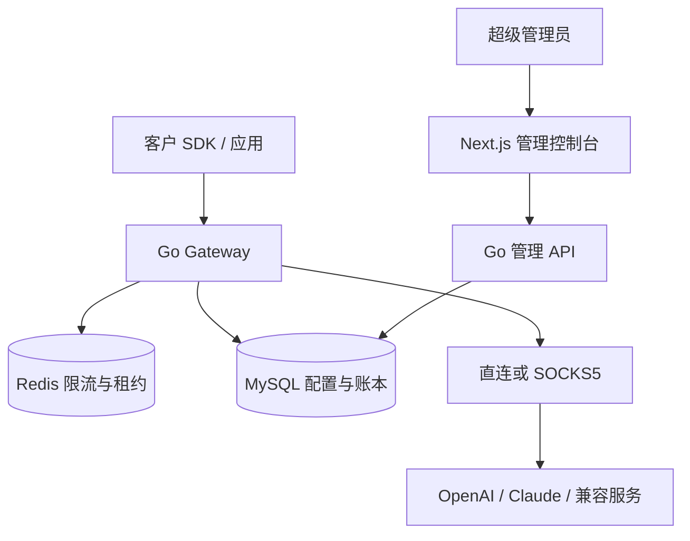

# RelayPine 产品与架构方案

用户在主站统一使用邮箱验证码登录，验证后获得独立工作区与初始为零的钱包。`ADMIN_APP_URL` 指向独立管理域名，只有 `SUPERADMIN_EMAIL` 指定的管理员能够进入。服务器按实际 Host、Origin、会话作用域和账号身份检查访问权限。Stripe 在线充值与支付处理已移除；管理员可通过审计额度调整为工作区记入余额。

模型批量导入时匹配官方标准参考价格，已定价模型使用 `metered` 预留并扣减 RelayPine 余额。参考价更新经过预览与版本检查；不匹配的型号保持禁用等待定价。历史 `usage_only` 请求保存不可变快照，不追溯补扣。

以下是核心网关结构与长期技术设计；超出当前范围的团队角色、在线收款和高级预算功能仍需另行实现。实际实现范围以 [README](../README.md) 和 [用量与额度说明](commercial-billing.md) 为准。

## 1. 平台与上游

区分协议平台、上游 Endpoint、凭据和账号作用域，避免把不同概念都塞进 Key 配置。

| 对象 | 作用与主要字段 |
| --- | --- |
| Provider | `openai` / `anthropic`；协议、默认地址、认证和用量解析适配器 |
| Endpoint | 名称、provider、origin、API 路径前缀、认证模式、支持端点、模型映射、价格表、状态 |
| Credential | 名称、加密 Key、endpoint、账号作用域、优先级、proxy、启停状态 |
| QuotaScope | 账号、组织、项目、workspace、模型共享组；父子关系；RPM、TPM、并发限制 |
| BudgetAccount | 币种、日/月/总预算、已结算、预留、重置时区；可绑定 Key、共享账号或访问 Key |
| Proxy | SOCKS5 主机、端口、加密凭据、DNS 策略、健康状态、配置版本 |
| AccessKey | 业务方访问凭据的哈希、允许的模型与路由组、预算、限流、有效期 |
| RoutingPolicy | 候选 Endpoint/Key、策略、优先级、等待时限、重试上限、降级权限 |
| Request / Attempt | 一次下游请求及其每一次上游尝试；路由理由、状态、上游 request ID |
| Reservation / UsageLedger | 金额预留、用量、结算和调整记录；幂等键与价格版本 |
| Tenant / Membership | 客户账户、成员角色、启停状态；客户资源必须携带 tenant_id |
| Project | 租户内业务隔离单元；访问 Key、Responses 资源和子预算归属项目 |
| CustomerWallet / WalletHold | 客户付费余额、赠送余额、冻结/预留；独立于上游预算账户 |
| PriceBook / PriceVersion | 模型销售单价、客户专属价、生效时间；请求固定成交价版本 |
| CustomerCharge / LedgerTransaction | 每次逻辑请求唯一费用单、不可变资金分录；与各 attempt 的上游成本关联 |

官方默认 origin：OpenAI 为 `https://api.openai.com`；Anthropic 为 `https://api.anthropic.com`。配置界面接受常见的完整 base URL，内部拆分 origin 与路径前缀，统一拼接一次 `/v1`。同一平台允许多个 Endpoint，第三方可配置 `/api/v1` 等路径前缀，但不能以客户端提供的任意 URL 发起转发。

每把 Key 绑定一个明确 Endpoint。修改 Endpoint 地址属于敏感配置变更，需要明确提示哪些 Key 和流量会被发送到新的服务方；不得将官方 Key 自动尝试到第三方 host。认证支持适配器默认值与明确允许的覆盖值，禁止客户端覆盖上游认证字段。

模型别名由路由组映射到具体上游模型 ID。只有被声明且经过验证的接口、模型和能力才进入候选；不能因第三方声称“OpenAI 兼容”就推定它也支持 Responses。

官方 API 来源：[OpenAI API 概览](https://developers.openai.com/api/reference/overview)、[Claude API 概览](https://platform.claude.com/docs/en/api/overview)。

## 2. 接口范围

| 协议 | 第一版端点 | 行为 |
| --- | --- | --- |
| Claude | `POST /v1/messages` | JSON/SSE，保留 tool use、thinking、usage 和未知新增字段 |
| Claude | `POST /v1/messages/count_tokens` | 经相同模型与权限筛选，使用该端点的限流规则 |
| OpenAI | `POST /v1/chat/completions` | JSON/SSE，不强制转换为 Responses |
| OpenAI | `POST /v1/responses` | 同步 JSON/SSE；资源引用必须遵循亲和路由 |
| OpenAI | `GET /v1/responses/{id}`、`DELETE /v1/responses/{id}` | 仅处理本中转已记录归属、调用方有权限的资源 |
| OpenAI | `POST /v1/images/generations`、`POST /v1/images/edits` | 仅 GPT Image 2 与 2.5；JSON/SSE，编辑接受上传图片或 base64 data URL；按图像 Token 计费 |
| 两者 | `GET /v1/models` | 返回当前访问 Key 允许使用的模型；按所属协议输出格式 |

入口建议为 `/openai/v1/*` 与 `/anthropic/v1/*`，使模型列表、错误格式和鉴权路径没有歧义。后续可用不同域名映射为各自的 `/v1/*`。客户端保持原生 SDK，仅调整 base URL 与访问 Key；具体 CLI 的端点覆盖通过验收后再声明兼容。

保留 Anthropic 的版本和允许的 beta 头；替换上游认证，过滤 hop-by-hop 头、Cookie、客户端伪造的组织/项目及内部路由头。上游组织/项目由管理员配置。

不做跨协议转换、Files/Vector Stores、Batch、background Responses、Realtime/WebSocket、音频端点或云厂商 IAM。允许的请求字段在协议内透传；涉及尚未支持的资源或会产生独立费用的内置工具，必须能力检查并明确拒绝。普通由客户端执行的工具调用可正常透传。

当前实现的图像能力：Images API 生成与编辑（GPT Image 2 与 2.5，按文本与图像 Token 精确计费）；Chat Completions 与 Responses 接受用户消息中的图片输入（Responses 还接受函数与自定义工具输出中的图片），来源限 https URL 或 base64 data URL，文件 ID 一律拒绝，以免引用同一上游账户中其他客户上传的文件；Responses 唯一放行的内置工具是 `image_generation`，图像模型固定、`max_tool_calls` 限制调用次数，按图像模型价格另计。参数采用白名单，未知参数可能改变费用，因此直接拒绝。

## 3. 额度与限流

OpenAI 限流存在于组织、项目及模型共享组；Claude 存在组织和 workspace 限制，并区分请求数、输入 token、输出 token。多把 Key 可能消耗同一份上游容量，不能逐 Key 独立计数后误判可用性。[OpenAI 限流](https://developers.openai.com/api/docs/guides/rate-limits)、[Claude 限流](https://platform.claude.com/docs/en/api/rate-limits)

所有请求同时检查 Key 自身、模型共享组及账号父级的限制。共享账号的余额只建立一份账本，不复制到每把 Key。内部 Key 预算可以在共享账号预算之下进一步收紧。

界面将“额度”分成三类：

| 类型 | 来源 | 可提供的保证 |
| --- | --- | --- |
| 本地预算 | 管理员设置上限，网关逐次记账 | 控制经过本网关的使用 |
| 手工维护余额 | 初始余额、充值、人工调整减去已知消耗 | 显示估算及最后调整时间 |
| 上游查询余额 | 特定供应商余额插件 | 显示来源、更新时间和有效期 |

官方 Usage/Cost 接口用于用量或历史成本核对，不等同普通推理 Key 的实时剩余余额接口。使用这些能力需要对应的管理权限，Admin Key 应与推理 Key 分开保管。[OpenAI Costs API](https://developers.openai.com/api/reference/resources/admin/subresources/organization/subresources/usage/methods/costs)、[Claude Usage and Cost API](https://platform.claude.com/docs/en/manage-claude/usage-cost-api)

当前实现的限流：每个请求按贴近实际的 Token 估算（文本约每 4 字节 1 个 Token，加图片上界、续接输入和输出上限）进入租户、访问 Key、上游 Key 和额度组当分钟的计数；计数低于限额就放行，单个大请求在空闲的 Key 上也能执行；请求结算后计数改为实际用量，被拒绝或预留失败的通道全额退回，用量未知时保留估算。计数口径与服务商一致：OpenAI 计入全部输入（含缓存）和输出；Anthropic 只计入未缓存输入和缓存写入（与其 ITPM 相同，Haiku 3.5 另计缓存读取），准入不加 `max_tokens`，输出由 Anthropic 的 OTPM 约束。RPM 与并发不受影响。OpenAI 与 Anthropic 在每个响应头中报告该 Key 的每分钟限额；网关按 Key 和模型保存最近一次的值（Redis，30 天），管理后台据此显示，便于把本地限额设为真实等级。上游 Key 的默认限额只是本地保护值，应配置为服务商的实际额度。

未知余额不当成无限，也不假装为零。在余额优先策略下，优先使用同币种、同口径且未过期的可比较余额；只有本地预算的 Key 可使用明确选择的“本地剩余预算”口径。未设置可比较预算的 Key 需配置备用顺序，不能偷偷混合排序。

## 4. 路由策略

先满足所有硬约束，再比较策略分数。候选 Key 必须启用、支持目标模型与端点、代理可用、未熔断且有足够预算和速率容量。同一优先级内支持：

| 策略 | 规则 |
| --- | --- |
| 负载优先，默认 | 选择预计发送后归一化负载最低的路线 |
| 额度优先 | 在通过容量检查的候选中，选择有效剩余额度最高的路线 |
| 均衡 | 按剩余容量和剩余预算分配权重，避免集中打满单个 Key |

公开服务还需先检查客户钱包、客户总 RPM/TPM/并发、访问 Key 子限额与可购买的模型/路由组。客户开多把访问 Key 不能突破租户总限额。路由策略中的“额度优先”比较上游 Key 的预算或余额，不比较不同客户的钱包；客户之间按独立限额及公平队列隔离。每个路由组声明可使用的供应商类型和能力，客户购买的官方专用路线不能静默转到第三方兼容服务。

负载初始定义：`max(RPM 利用率, TPM/ITPM/OTPM 利用率, 并发利用率)`，取所有适用父级和共享组中的瓶颈值。加入本次预计消耗及已预留请求；未配置的维度不参与，缺失所有限制则要求设置保守的本地默认上限。接近的分数随机打散，最后用 Redis 原子获取令牌和并发租约；竞争失败后重新选路，不能只读余额再发送。

默认不排长队，允许配置短等待，例如最多 2 秒。限流返回该协议的 429 和可确定的 Retry-After；暂时没有健康路线返回 503；权限或模型不支持返回明确的配置/请求错误。队列有数量与时长上限，取消请求立即移出。

响应头用于反馈和收紧本地限流估计，不能因较早请求的延迟响应把剩余容量错误增加。外部绕过本网关的流量无法被本地精确计数，遇到上游限流仍须按共享作用域冷却。

## 5. 上游预算预留和结算

每次尝试使用独立 `attempt_id`。金额用整数最小单位或定点数，记录币种与价格版本；禁止用浮点累加费用。

1. 按模型定价预留输入、最大输出及适用缓存费用。严格预算模式需要可信的 token/成本上界；只有估算时加入保守余量并显示控制精度，不能声称绝对不超支。输出上限缺失时使用明确配置的上限；对不能建立成本上界的能力不承诺硬预算。
2. 在 MySQL 事务内锁定适用预算账户，按稳定顺序检查并预留金额，防止并发透支。
3. 获取 Redis 中所有速率令牌及并发租约。失败则撤销尚未发送的预算预留，再重新选路。
4. 记录发送意图后再发起上游调用。发生崩溃时，只对可证明未发送的尝试自动退款。
5. 收到 usage 后幂等结算，区分输入、输出、缓存读写及供应商报告的其它计费项，释放预留差额。
6. 流中断或 usage 缺失时记录待核对/估算金额，不能直接当作免费请求。估算和实收分别展示。

长上下文价格：部分模型在 prompt 超过阈值时整单按更高价格计费（OpenAI 新模型超过 272K 输入 Token，Claude Haiku 5.5 超过 100K Token）。参考价导入时一并写入；输入上界超过阈值时按两档中较高的金额预留，结算时按上游报告的 prompt 长度（含缓存读写）选档。没有加价档的模型在其上下文窗口内只有一个价格，不因长度被拒。

图像请求的上界同样必须真实可靠，因为客户扣款不超过预留：Images API 按 OpenAI 的输出 Token 计算器和尺寸、质量、张数预留，Responses 图像工具按每次调用的最坏情况预留。图像工具的费用只出现在 `tool_usage.image_gen`，OpenAI 说明它可能缺失或少报，因此结算时按报告值且不低于每张已完成图像的计算器值，没有报告时按最坏情况计费。

MySQL 是预算账本权威来源；Redis 管速率和并发，避免两个系统分别作为金钱余额的权威。跨存储没有天然原子事务，使用持久状态机、补偿和恢复扫描。预算预留有恢复期限；并发租约有心跳，但租约过期不代表上游未产生费用。恢复任务必须通过状态版本比较或行锁领取，确认尝试不再活跃后才补偿，防止与仍运行的发送协程竞态退款。恢复与结算用唯一约束阻止重复扣款或退款。Redis 或预算数据库不可用时停止接纳新的收费请求。

每份日/月预留绑定具体预算期间及其时区；跨周期完成仍结算到原预留期间。周期重置创建新期间，不清空旧期间的未完成预留或账目。

多次尝试分别记录上游成本，汇总到同一客户端请求用于运营统计；客户费用按已锁定销售价和唯一逻辑请求结算，不把各 attempt 的成本相加后转嫁给客户。缓存折扣、第三方自定义价格和共享余额不得重复扣除。网关之外的消费通过后续同步校正，不能许诺覆盖不可见流量的真实余额保证。

## 6. 重试与流式转发

原样转发 SSE 数据，同时旁路解析状态和 usage；保留未知事件，按背压输出，不累积整段回答。含生成图像的回复体积大：非流式 Images 回复边收边转发，只保留 usage 等小字段；Responses 图像回复与流式图像事件在解析和存档时去掉 base64 图像，存档记录原始大小。客户端断开后取消上游请求并释放本地连接资源。

| 场景 | 处理 |
| --- | --- |
| 能确认尚未发送的连接失败 | 在允许的路由组内有限切换 |
| 已发送但是否执行不明 | 默认不重放；记录结果未知 |
| 401 | 隔离该凭据并记录原因 |
| 403 | 区分模型权限、账号权限和配置问题 |
| 暂时 429 | 某个模型的限额：只暂停该 Key 及其额度组上的这个模型（按 Retry-After）；计费、额度或消费上限：暂停整把 Key 至少五分钟 |
| 预算或上游余额耗尽 | 标记相关账户不可用，等待调整或可信同步 |
| 5xx/过载 | 短暂熔断；仅在已确认适合重试且响应未提交时有限切换 |
| 已向客户端提交响应头或内容 | 不自动切换、不拼接第二次回答 |

当前实现：上游在产生输出前明确拒绝（请求未发出，或 HTTP 401/402/403/429/5xx）时，请求在同一预留下换到下一条候选路线，最多三条，官方及兼容路线优先，管理员配置的 OpenRouter / ZenMux 备用通道最后；被拒绝的尝试按零成本关闭并把上游预留转给下一把凭据。连接状态不明确的失败仍不重放，遵守整体超时和业务幂等边界。备用通道是管理员显式配置的例外：它用自己的 Key 承接官方模型，不会把官方 Key 发往第三方 host；Responses 资源和 Token 计数不使用备用通道。网关统一控制重试，避免 SDK 内置重试叠加。非幂等资源操作不因尚未输出就自动重试。

Claude 的 SSE 可包含错误，累计 usage 不能逐帧相加，所以成功判定需要终止事件与协议状态，而不仅是 HTTP 200。[Claude Streaming](https://platform.claude.com/docs/en/build-with-claude/streaming)

## 7. 会话与资源归属

普通请求携带完整历史时可以换 Key；缓存亲和属于软偏好，容量不足时允许改道。

OpenAI Responses 的 `previous_response_id` 是上游状态引用，因此设计上必须记录 `tenant_id + project_id + response_id → endpoint + 上游账号作用域 + 原始上游凭据`。第一版保守绑定原上游 Key；客户访问 Key 只是凭据，轮换后只要仍获准访问原项目即可续接，不能把资源永久绑定被撤销的客户 Key。GET/DELETE 校验同一租户及项目归属。映射持久化，找不到归属时明确返回错误。原上游 Key 不可用时不能随意切换到另一供应商；同上游账号换 Key 需以后显式验证访问能力。[OpenAI 会话状态](https://developers.openai.com/api/docs/guides/conversation-state)

含 response ID 的 JSON 或 SSE 事件在发送给客户端前，必须先持久化归属映射，避免客户端立即续接时查不到记录。写入失败不能先暴露该 ID；应中止转发、取消上游并记录待结算状态。

对尚未支持的 conversation、file、vector store 等引用明确拒绝，避免随机路由后出现难以诊断的资源不存在错误。

## 8. SOCKS5 与网络边界

每 Key 的出口模式必须明确：`direct` 或指定 `proxy_id`。多个 Key 可以复用一个代理配置，但连接池按 Endpoint、代理、TLS 和配置版本隔离；更新出口后让旧连接池退出新流量并关闭空闲连接。Go 标准 HTTP Transport 支持 SOCKS5，可用于长期复用连接。[Go Transport](https://pkg.go.dev/net/http#Transport)

配置代理的 Key 遇到代理故障，只能等待恢复或换另一条已获准的路线，不自动直连。代理故障按代理组冷却，避免把共享同一坏出口的每把 Key 都重试一遍。

测试分为 TCP/SOCKS 握手、TLS/供应商连通性，以及由管理员主动触发的最小真实请求；界面区分测试类型、延迟、认证失败和模型权限失败，真实请求消耗同样计入账本。

仅管理员可配置上游和出口。默认上游 HTTPS、禁止自动重定向，防止认证头被发送到新 host。拒绝 metadata、回环和未获准的私网目标；私有兼容服务通过精确 allowlist 开放。DNS 校验与实际拨号需一致；代理侧解析 DNS 时由可信出口落实目标限制，或发送经验证 IP 并保留 TLS SNI，不能只依赖网关的预先 DNS 查询。

上游 Key 与代理密码应用层加密，主密钥从部署 Secret 注入并支持版本轮换。业务访问 Key 只存哈希，创建时显示一次；上游 Key 在列表脱敏。运行日志只记元信息、用量和路由原因，不记录凭据。为控制台的请求详情，网关另存客户端原始请求正文和客户端实际收到的响应：压缩后用主密钥加密并绑定请求 ID，默认长期保留，可按天数设置保留期。正文存于 MySQL；配置 S3 兼容对象存储后，正文在响应结束后上传，MySQL 只保留索引，存储服务只能看到密文。请求头只保留诊断所需的白名单，从不保存访问 Key、上游 Key 或 Cookie。未返回给客户端的上游原始回复只有管理员可见。

## 9. 运营后台与客户控制台

使用统一侧栏和表格布局，默认英文，中文文案集中维护；单项目统一 HeroUI。页面按实际操作组织：

| 页面 | 主要操作与信息 |
| --- | --- |
| Overview | 请求量、成功率、首 token 延迟、费用、限流/故障趋势 |
| Providers | 官方默认值、第三方 Endpoint、模型及接口能力、价格 |
| API keys | 批量添加、分组、启停、共享组、预算、当前负载、指定代理 |
| Quotas | 组织/项目共享限制、预算余额、预留金额、重置规则 |
| Proxies | 新增出口、关联 Key、连通性与故障状态 |
| Routing | 策略、优先级、候选范围；输入模型查看选路解释 |
| Customers | 客户状态、成员、钱包、客户总限额、专属价、允许的路由组 |
| Access keys | 管理客户访问 Key 的启停与权限；上游密钥不向客户展示 |
| Pricing | 模型销售价、价格版本、客户覆盖价、生效时间 |
| Balance & ledger | 内部额度、请求预留、实际用量和带理由的人工调整 |
| Requests | 请求及各次尝试、命中 Key/出口、用量来源、费用、错误原因 |
| Settings | 管理员权限、审计记录、保留时间与告警阈值 |

余额展示来源与更新时间。模型不支持、Key 无效、代理断开、共享组限流和余额不足要能区分。后台数据从真实 API 获取，空状态明确引导添加上游。

用户控制台提供本人工作区的 API Key、用量、余额和已发布模型售价。独立管理站提供上游、价格同步、代理、路由和客户额度管理；主站即使由管理员登录也只返回客户视图。所有访问检查均在服务端执行，不依赖前端隐藏按钮。

## 10. 部署结构

Go 网关、用户 API 和管理员 API 在同一代码库按模块隔离；管理员 API 额外检查管理域名和固定管理员身份，中转入口检查租户访问 Key 和余额。前端独立部署。结算恢复作为进程内任务运行；当前无支付入口、支付 worker 或外部收款。

建议结构：`apps/console`、`services/gateway`、`contracts`、`deploy`、`docs`。关系模型和数据库迁移统一由服务端维护，避免两个 ORM 各自修改 schema。Redis 脚本与部署先按单主拓扑设计；以后采用 Cluster 时需确保原子操作涉及的 key 在同一 slot，或重设分区方式。

部署需验证 SSE 不被入口代理缓冲，区分连接、首字节、流空闲和总时长超时；滚动发布先停止接纳新流量，再排空进行中的流。配置更新带版本，停用 Key 必须及时撤销新请求路由资格。
